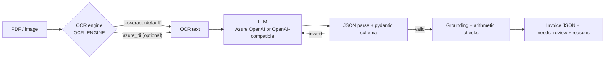

# Document Extraction (OCR + LLM)

Turns invoices (text PDFs or image scans) into strict, validated JSON. Validation, grounding checks and the
"needs review" flag are plain Python, not LLM calls.

> **All data in this repo is synthetic.** The 20 sample invoices in `data/sample/` are generated by
> `src/doc_extraction/synthetic.py`. No real documents are used.

## What it does
1. Reads a PDF or image with OCR.
2. Asks an LLM for JSON that matches a fixed schema, using only values printed on the document.
3. Validates the JSON with pydantic. If it is not JSON or fails the schema, it retries up to 2 times, feeding the error back.
4. Checks every extracted value against the OCR text (grounding) and checks the arithmetic (line totals, subtotal + tax = total).
5. Sets `needs_review` and lists the reasons if anything fails these checks.

## Architecture


## Tech
Python 3.11, pydantic, pypdf, Tesseract (pytesseract), OpenAI SDK (Azure OpenAI or any OpenAI-compatible endpoint), pytest, Docker.

## How to run
```powershell
python -m venv .venv
.venv\Scripts\pip install -r requirements.txt     # Tesseract must also be installed (winget install UB-Mannheim.TesseractOCR)
copy .env.example .env                             # fill in your own values; .env is git-ignored
```
Load your environment variables, then:
```powershell
$env:PYTHONPATH = "src"
python -m doc_extraction data\sample\invoice_02.pdf
```
Configuration is by environment variables only (see `.env.example`):

| Purpose | Variables |
|---|---|
| Azure OpenAI, key mode (default) | `AZURE_OPENAI_ENDPOINT`, `AZURE_OPENAI_API_KEY`, `AZURE_OPENAI_DEPLOYMENT`, `AZURE_OPENAI_API_VERSION` |
| Azure OpenAI, sign-in mode (used when `AZURE_OPENAI_API_KEY` is not set) | the same endpoint/deployment/version, plus `AZURE_TENANT_ID`, `AZURE_CLIENT_ID`, `AZURE_CLIENT_SECRET` |
| Any OpenAI-compatible endpoint | `OPENAI_API_KEY`, `OPENAI_BASE_URL`, `OPENAI_MODEL` |
| OCR engine | `OCR_ENGINE=tesseract` (default) or `azure_di` (+ `AZURE_DI_ENDPOINT`, `AZURE_DI_KEY`, `pip install -r requirements-azure.txt`) |

Tests need no key (they use a fake LLM). One optional live test is skipped unless LLM variables are set:
```powershell
python -m pytest -q -rs
```
Regenerate the sample data: `python -m doc_extraction.synthetic`.

## Design choices
- **Validation in code, not the LLM.** The schema, arithmetic checks, grounding and review flag are deterministic and unit-tested.
- **Hallucination control.** The prompt allows only printed values and `null` for missing ones. Every extracted value is then
  searched for in the OCR text; values not found are flagged. Dates are matched in several printed formats.
- **Bad output handling.** Non-JSON, wrong-schema or empty output triggers a retry with the error message; after the retries the
  document is returned with no invoice and `needs_review = true`. OCR failures are also review items, never crashes.
- **Swappable parts.** OCR engine and LLM provider change through environment variables only.
- **Sample data is deliberately imperfect:** four printed date formats, some invoices without a customer or tax line, and
  blurred, noisy, tilted image scans.

## Evaluation results
Run `python -m doc_extraction.evaluate --live` (real LLM, from environment variables) on the 20 synthetic documents.
On a rate-limited free tier add `--delay SECONDS` (for example `--delay 13` for 5 requests/minute); the client also waits and retries on HTTP 429 (up to 6 times).
Progress ("3/20 done") is printed to stderr.
`--mock` only checks the plumbing (the fake LLM returns the ground truth) and is **not** an accuracy measurement.

**Live run:** model `gemini-3.1-flash-lite` via an OpenAI-compatible endpoint, Tesseract OCR, the 20 synthetic invoices in
`data/sample/`. The data is synthetic and the set is small, so **these results apply to this test set only**. Raw output: `docs/eval_live.json`.

| Measure (20 synthetic docs, live LLM) | Result |
|---|---|
| Field-level accuracy | 0.9778 (176 of 180 fields) |
| Fully correct documents | 16/20 |
| Documents with no valid output | 0/20 |
| Wrong documents flagged for review | 4/4 |
| Correct documents flagged unnecessarily | 1/16 |

Per-field accuracy: invoice_number 1.00, invoice_date 0.90, vendor_name 0.95, customer_name 1.00, currency 1.00,
subtotal 1.00, tax 1.00, total 1.00, line_items 0.95.

**What the errors were.** `docs/eval_live.json` holds only totals, not per-document details, so this is what the numbers show:
- There were 4 wrong fields in 4 different documents (one wrong field each): 2 invoice dates, 1 vendor name, 1 line-items list.
- Money fields (subtotal, tax, total) and customer name, including the documents with no customer or tax line, were all correct.
- All 4 wrong documents were caught by the review flag. One correct document was flagged unnecessarily.
- The cause of each error (OCR misread on a degraded scan, or a date-format mix-up) is not recorded, so I am not claiming one.
  A per-document error log is a next step.

## Limitations
- Scanned PDFs without a text layer are not supported by the Tesseract engine (they are flagged for review). Rendering them would need an extra PDF-to-image step.
- The Azure Document Intelligence OCR option is implemented but **untested** against a real resource.
- Evaluation uses only 20 synthetic invoices in one layout family; results will not transfer to real documents.
- Slash-formatted dates are read as day/month/year only.
- The grounding check confirms a value appears in the OCR text, not that it is the right field, so it can miss swapped fields.
- Single-page, English, one currency.
- The Docker image has not been built and verified yet.

## Next steps
- Log per-document errors in the evaluation output to explain each miss.
- Verify the Docker image; add scanned-PDF support; try the Azure OCR engine.
- Add more invoice layouts and a small CLI for folders.
